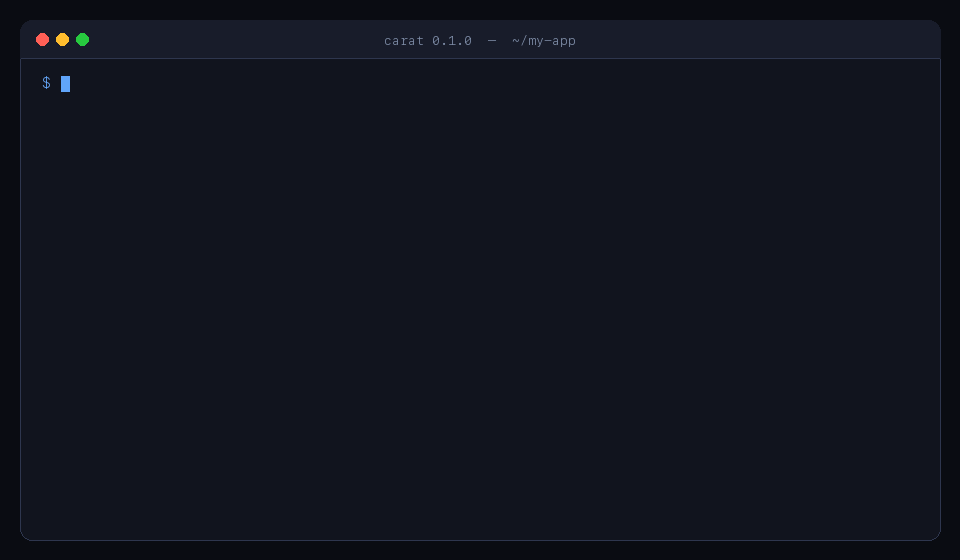

# Carat

**A balance sheet for npm dependency changes.**

When an npm package is added or updated, Carat inspects the published tarball in memory, accounts for every changed byte against the previous release and public Git source, prints the exact leftover diff if anything does not match, and stops before `npm ci` runs when something breaks.

Single Rust binary. Zero runtime dependencies beyond `git`, `curl`, and `npm`. Built for both humans and coding agents.



---

## What Carat shows you

```text
$ carat add chalk@5.4.1 --install
Carat: 0 of 1 changed package(s) need a person

ok    1 package(s) fully explained
Installed exact checked lockfile via `npm ci --ignore-scripts`.
```

Even when every file matches Git source, Carat stops on historical continuity breaks (such as a repository ownership change) and prints the exact approval ID:

```text
$ carat explain ms@2.1.2..2.1.3
STOP  ms 2.1.2 -> 2.1.3
      anchor: 1c6264b79549 via GitHead @ https://github.com/vercel/ms
      published: 2173d ago (Settled)
      balance: 4 of 4 files accounted for (0 carried, 4 changed = 6.6 KiB)
        - Source                4 file(s),   6.6 KiB
      breaks:
        ! source repository changed — repository changed to https://github.com/vercel/ms
      why stopped:
        - source repository changed (repository changed to https://github.com/vercel/ms)
      approve with: carat approve 12b0130186a9334e
      subject: 4dbf5392e222bdab | ledger: 12b0130186a9334e
```

---

## Install in 60 seconds

Prerequisites: `git`, `curl`, and `npm` (plus `cargo` if installing via crates.io or source).

### Cargo (crates.io)

```bash
cargo install carat
```

### Prebuilt binary (Linux & macOS)

Download the tarball for your platform from [GitHub Releases](https://github.com/steph4n-gh/carat/releases) and verify its SHA-256 against `SHA256SUMS.txt`:

```bash
# Example (macOS Apple Silicon; replace target for x86_64-apple-darwin,
# x86_64-unknown-linux-gnu, or aarch64-unknown-linux-gnu):
TARGET="aarch64-apple-darwin"
curl -fsSLO "https://github.com/steph4n-gh/carat/releases/download/v0.1.0/carat-${TARGET}.tar.gz"
curl -fsSLO "https://github.com/steph4n-gh/carat/releases/download/v0.1.0/SHA256SUMS.txt"
grep "carat-${TARGET}.tar.gz" SHA256SUMS.txt | shasum -a 256 -c -
mkdir -p ~/.local/bin && tar -xzf "carat-${TARGET}.tar.gz" -C ~/.local/bin
```

### Build from source (includes agent skill installer)

```bash
git clone https://github.com/steph4n-gh/carat.git
cd carat
./scripts/install.sh --install-skill
```

This builds and installs `carat` to `~/.local/bin/carat` and installs the coding-agent skill to `~/.claude/skills/carat/SKILL.md` and `~/.codex/skills/carat/SKILL.md`.

Bootstrap any Node.js repository:

```bash
carat init --github --mcp
```

---

## Core workflows

### Check and install a package (zero re-resolution TOCTOU)

```bash
carat add zod@4.6.7 --install
```

Carat resolves the lockfile once inside an isolated `0700` temp directory with lifecycle scripts disabled, verifies every changed package in memory, and writes that exact checked `package-lock.json` before running `npm ci --ignore-scripts`.

### Inspect any registry version jump

```bash
carat explain chalk@5.4.0..5.4.1
```

Pass `--read` with `ANTHROPIC_API_KEY` set (or an external `reader.command` configured via `--config`) to have an LLM security reader inspect unexplained code diffs with verified line citations.

### Gate pull requests in CI without running PR code

Install [docs/workflows/carat-pr.yml](docs/workflows/carat-pr.yml). The workflow runs on `pull_request_target`, checks out only the protected base revision, reads PR lockfiles strictly from Git object storage, and posts a single summary comment. Maintainers approve stops by commenting a single standalone line:

```text
carat approve <16-hex-ledger-id>
```

### Wire Carat into coding agents

1. **MCP Server (`carat mcp`):** Run `carat init --mcp` to print the MCP config exposing `carat_explain`, `carat_check`, and `carat_add`. Agents have no approval tool and cannot bypass stops.
2. **Pre-Install Shell Guardrail:** Point your agent's `PreToolUse` Bash hook at [scripts/pre-install-hook.sh](scripts/pre-install-hook.sh) to block raw `npm install`, `npm add`, and `npm update` commands and redirect agents to `carat add <pkg> --install --json`.
3. **Agent Rules & Skill:** Copy [AGENTS.md](AGENTS.md) or install [skills/carat/SKILL.md](skills/carat/SKILL.md).

---

## The five verification layers

| Layer | What it checks | Determinism |
| --- | --- | --- |
| **1. Byte** | In-memory streaming `.tgz` inspection, SHA-512 SRI integrity, path escape, link, multi-root, BOM, and tar EOF differential checks | 100% deterministic |
| **2. Source** | Anchors release to public Git (`provenance → tag → gitHead`), checks branch reachability, and proves file bytes match Git blobs by SHA-256 | 100% deterministic |
| **3. History** | Compares release against prior stable history (`provenance_lost`, `repo_changed`, `anchor_lost`, `install_script_new`, `registry_manifest_differs`, OSV `MAL-*`) | 100% deterministic |
| **4. Reach** | Scans unexplained bytes for newly introduced capabilities (`child_process`, network calls, `eval`, env reads, new hostnames, minified code) | 100% deterministic |
| **5. Reader** | Optional LLM review of unexplained code diffs only. Every finding must cite real lines and a verbatim excerpt. Reader output can only raise concern and can never lift a deterministic stop | Contained & verifiable |

---

## Documentation

| Guide | Purpose |
| --- | --- |
| [docs/QUICKSTART.md](docs/QUICKSTART.md) | Step-by-step tutorial: install, inspect, add, and initialize a repo |
| [docs/HUMAN-GUIDE.md](docs/HUMAN-GUIDE.md) | Daily developer workflows, approvals, exposure tracing, and offline replay |
| [docs/AGENT-GUIDE.md](docs/AGENT-GUIDE.md) | MCP server setup, pre-install hook, JSON contract, and escalation protocol |
| [docs/CI-SETUP.md](docs/CI-SETUP.md) | GitHub Actions `pull_request_target` deployment, binary pinning, and PR approvals |
| [docs/CLI-REFERENCE.md](docs/CLI-REFERENCE.md) | Complete CLI flags, exit codes, `carat.toml` schema, and `S1`–`S10` stop rules |
| [docs/ARCHITECTURE.md](docs/ARCHITECTURE.md) | Pipeline internals, deterministic record model, and reader containment |
| [SECURITY.md](SECURITY.md) | Threat model, security invariants, non-goals, and vulnerability reporting |
| [SPEC.md](SPEC.md) | Full technical specification (draft 0.2) |
| [CONTRIBUTING.md](CONTRIBUTING.md) | Building, testing, and repository invariants for contributors |

---

## License

[MIT](LICENSE)
