# Architecture

Carat separates deterministic cryptographic accounting (`carat-core`) from network I/O, subprocess isolation, and optional LLM review (`carat-cli`).

## Pipeline overview

```mermaid
flowchart LR
    Lock["Lockfile v3 Diff & Registry Metadata"] --> Byte["1. Byte Layer\nIn-memory .tgz + SHA-512 SRI"]
    Byte --> Source["2. Source Layer\nprovenance / tag / gitHead + SHA-256"]
    Source --> History["3. History Layer\nStable baseline + OSV + manifest diff"]
    History --> Reach["4. Reach Layer\nCapability & hostname delta"]
    Reach --> Ledger["TransitionLedger\n(timeless, content-addressed)"]
    Ledger --> Decision["Decision\n(evaluated at explicit as_of)"]
    Ledger --> Packet["ReadingPacket\n(unexplained diffs only)"]
    Packet --> Reader["5. Reader Layer\nGrounded citations only"]
    Reader --> Decision
    Decision --> Verdict{"Verdict"}
    Verdict -->|explained / read| Pass["Exit 0"]
    Verdict -->|stop| Stop["Exit 1 (Human Approval Required)"]
```

---

## Crate boundary

- **`crates/carat-core`**: Pure library with zero network access, zero subprocess calls, and zero implicit system clock reads. All JSON records are serialized in canonical key-sorted order so IDs (`canonical_id`) are reproducible across machines and platforms.
- **`crates/carat-cli`**: Thin operational shell around `carat-core`. Handles hardened `curl -q --` and `git` subprocesses, local atomic store I/O, `npm` lockfile isolation for `carat add --install`, Git-object-only PR evaluation, and stdio JSON-RPC 2.0 MCP serving.

---

## The five verification layers

### 1. Byte layer (`archive.rs`, `digest.rs`, `lockfile.rs`)
- Validates lockfile v3 entries: single-digest `sha512-` SRI only, HTTPS `registry.npmjs.org` hosts, exact match against registry `dist.tarball` and `dist.integrity`, workspace root separation, manifest-lockfile sync, and ancestor tarball verification for nested `inBundle` entries.
- Streams `.tgz` archives strictly in memory through `MultiGzDecoder::take(max_expanded_bytes + 1)`. Never extracts untrusted archives to disk.
- Computes SHA-256 and Git blob SHA-1 per entry and records `S3` anomalies on path escapes, links, special files, duplicate or case-colliding paths, multi-root tarballs, lone zero-block tar differentials, or unparseable `package.json`.

### 2. Source layer (`source.rs`, `normalize.rs`, `fetch.rs`)
- Resolves an anchor in security priority order: **Provenance attestation → Git tag → `gitHead`**.
- Validates public HTTPS Git URLs (blocking private/loopback IPs and local hostnames) and pins a clean bare Git cache config with `safe.bareRepository=explicit` and `GIT_DIR`.
- Checks branch/tag ancestry for unsigned `gitHead` commits so commits living only in an attacker fork trigger `AnchorUnreachable`.
- Matches each non-carried tarball file to the anchor tree using Git blob SHA-1 for lookup, then confirms byte equality with SHA-256. Two declared normalizations are allowed: CRLF-to-LF (`SourceNormalized`) and explicit benign `package.json` publish transforms (`compare_published_manifest`).

### 3. History layer (`history.rs`)
- Builds a stable-release historical slice strictly older than the new version's publish timestamp (excluding prereleases when evaluating a stable release so prerelease flooding cannot hide breaks).
- Detects `known_malicious` (OSV `MAL-*`), `registry_manifest_differs`, `anchor_lost`, `provenance_lost`, `repo_changed`, `source_match_drop`, `unexplained_appeared`, `install_script_new`, `install_script_changed`, and `native_or_binary_new`.

### 4. Reach layer (`reach.rs`)
- Scans unexplained non-carried files for capabilities not already present in the reference release: process execution, network access, dynamic code evaluation, filesystem writes, environment reads, native/binary loading, new external hostnames, and newly introduced minified files.

### 5. Reader layer (`packet.rs`, `reader.rs`, `reader_exec.rs`)
- Runs only when unexplained code/manifest bytes, flags, or new reach remain and `--read` is passed.
- Packages only unexplained diffs (never skipping declared `bin` or entry files regardless of extension), splits minified single-line files for readable diffs, sanitizes control characters in unit headers, and assigns unique sequential unit IDs.
- Validates every reader finding in `carat-core`: `unit_id` must exist, `start_line..=end_line` must be in bounds, and `excerpt` (after stripping diff prefixes) must be non-empty and match verbatim inside those lines.
- Any ungrounded finding, schema error, or over-length output marks the reading `Invalid` (`S8` stop). Reader output can never lift a deterministic stop.
- Completed readings (`Passed`, `Concern`, `Refused`) are cached under a 64-char SHA-256 key binding `(ledger_id, packet_hash, instruction_hash, model, effort, command)`. Outages (`Unavailable`, `Invalid`) are never cached.

---

## Deterministic record model

| Record | Stored at | Time-dependent? | Purpose |
| --- | --- | --- | --- |
| `ArtifactProfile` | `.carat/profiles/<id>.json` | No | Facts about one tarball and its source anchor |
| `TransitionLedger` | `.carat/ledgers/<id>.json` | No | Complete byte balance, breaks, flags, and reach delta for one transition |
| `Decision` | `.carat/decisions/<subject>.json` | Explicit `as_of` only | Policy evaluation (`S1`–`S10`, `stop_facts`, `verdict`) at a given timestamp |
| `ReadingRecord` | `.carat/readings/<cache_key>.json` | No | Validated LLM reading output bound to `ledger_id` and `packet_hash` |
| `ApprovalRecord` | `.carat/approvals/<subject>.json` | Recorded `approved_at` | Human approval bound to exact `approved_facts` for `S10` staleness checks |

Keeping `ArtifactProfile` and `TransitionLedger` free of wall-clock timestamps ensures that `carat replay .carat/inputs/<ledger_id>` reproduces the exact same `ledger_id` byte-for-byte years later with zero network access.
